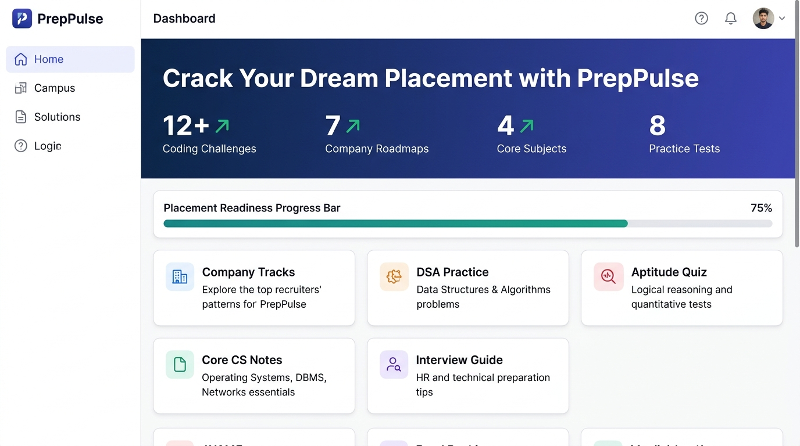
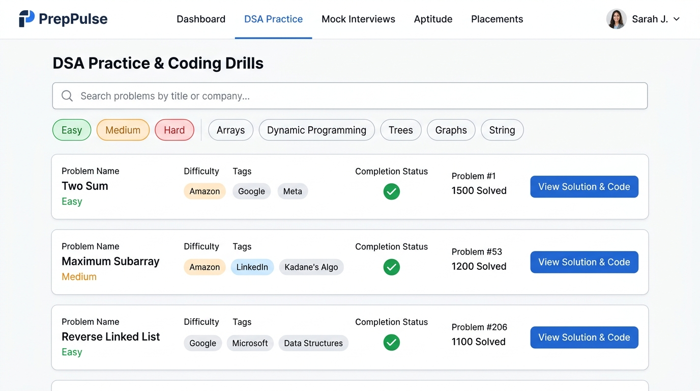

# PrepPulse — Campus Placement Preparation Portal

**Course:** Full Stack Web Development  
**Assignment:** Assignment 2 — Individual Project  
**Student Name:** S.Uzaif Ahamed  
**Registration Number:** A24126552178  

---

## 📌 Project Overview

**PrepPulse** is a full-featured, responsive, interactive **Campus Placement Preparation Portal** built with **React.js, HTML5, CSS3, and structured dummy JSON data**.

It equips engineering and computer science students with a structured preparation path to crack technical assessments and interviews at top tier-1 product companies (Amazon, Microsoft, Google) and service leaders (TCS Digital, Infosys SP, Wipro Turbo, Accenture).

---

## 📸 Screenshots

### 1. Dashboard & Placement Readiness Overview


### 2. DSA Practice & Coding Drills with Filters & Solution Viewer


---

## 🚀 Key Features

1. **📊 Interactive Dashboard & Readiness Meter:**
   - Real-time placement readiness gauge computed dynamically from completed DSA challenges and checklist milestones.
   - Quick statistics: Coding challenges, company roadmaps, core subjects, and practice tests.

2. **🏢 Target Company Tracks:**
   - In-depth recruitment workflows for **Amazon, Microsoft, Google, TCS Digital, Infosys, Wipro, and Accenture**.
   - Details on CTC brackets, role definitions, round-by-round syllabus, and hot interview topics.
   - Filter by Tier difficulty (`Hard` / `Medium`).

3. **💻 Data Structures & Algorithms (DSA) Drills:**
   - Curated list of high-frequency interview questions across Arrays, Strings, Linked Lists, Trees, Dynamic Programming, and Sorting/Searching.
   - Real-time search by problem name or company tag.
   - Difficulty pills (`Easy`, `Medium`, `Hard`) and Category filters.
   - Interactive modal popup with **Problem Statement**, **Hint reveal toggle**, and **Optimal JavaScript solution code** with 1-click clipboard copy.
   - Checkbox toggle to track solved problems (persisted across sessions via `localStorage`).

4. **📝 Interactive Aptitude & Technical Quiz:**
   - Timed multiple-choice questions covering Quantitative Aptitude, Logical Reasoning, and Technical fundamentals.
   - Immediate score calculation, performance percentage, and detailed answer explanations for every question.
   - Retake quiz functionality.

5. **📚 Core CS Fundamentals Flashcards:**
   - High-yield interview revision cards for:
     - **DBMS**: ACID Properties, Normalization, SQL vs NoSQL, Indexing.
     - **Operating Systems**: Processes vs Threads, Deadlock & Coffman conditions, Scheduling, Paging.
     - **Computer Networks**: OSI vs TCP/IP, TCP vs UDP, 3-Way Handshake, DNS workflow.
     - **OOPs**: 4 Pillars, Overloading vs Overriding, Abstract classes vs Interfaces, SOLID.

6. **🎙️ HR & Behavioral Interview Preparation:**
   - Common behavioral and fitment interview questions.
   - Structured answering strategies utilizing the **STAR framework** (Situation, Task, Action, Result).
   - Expandable model answers.

7. **✅ Placement Preparation Checklist:**
   - Milestone checklist covering resume ATS optimization, coding targets, project deployment, and profile tuning.
   - Dynamically impacts the dashboard readiness score.

---

## 🛠️ Technology Stack

- **Frontend Library:** React.js (Hooks: `useState`, `useEffect`)
- **Structure:** Semantic HTML5
- **Styling:** Custom Vanilla CSS3 Design System (CSS Custom Properties, Flexbox, CSS Grid, Transitions)
- **Data Source:** Structured Dummy JSON dataset (`data.json`)
- **Local Persistence:** Browser `localStorage` for completed problems and checklist states

---

## 📁 Component Hierarchy & Directory Structure

```text
Assignment-2-Individual-Project/
├── README.md                               # Project documentation & screenshots
├── package.json                            # Scripts & metadata
├── screenshots/                            # Project submission screenshots
│   ├── 01-dashboard-overview.jpg
│   └── 02-dsa-coding-practice.jpg
└── src/
    ├── index.html                          # Entry point supporting zero-dependency browser execution
    ├── style.css                           # Complete responsive CSS design system
    ├── data.json                           # Comprehensive placement dummy dataset
    ├── App.jsx                             # Root React component managing tabs & global state
    └── components/
        ├── Navbar.jsx                      # Navigation bar & student profile badge
        ├── Dashboard.jsx                   # Hero banner, stats & quick access cards
        ├── CompanyTracks.jsx               # Company profiles & round timelines
        ├── DsaPractice.jsx                 # DSA problem list with search & filter
        ├── QuestionModal.jsx               # Solution viewer with code copy & hint
        ├── AptitudeQuiz.jsx                # Interactive quiz engine & score review
        ├── CoreSubjects.jsx                # Color-coded CS revision cards
        ├── InterviewGuide.jsx              # Behavioral Q&A with STAR strategies
        └── ChecklistTracker.jsx            # Dynamic placement milestone checklist
```

---

## ⚡ How to Run the Project

### Option 1: Direct Browser Launch (Zero-Setup)
Simply open [`src/index.html`](./src/index.html) directly in any modern web browser (Google Chrome, Microsoft Edge, Firefox, or Safari). It automatically loads React and Babel Standalone with the embedded data.

### Option 2: Using Node & npm
```bash
# Navigate to the project directory
cd Assignments/Assignment-2-Individual-Project

# Start local preview server
npm start
```
Open `http://localhost:3000` or the displayed local port in your browser.
