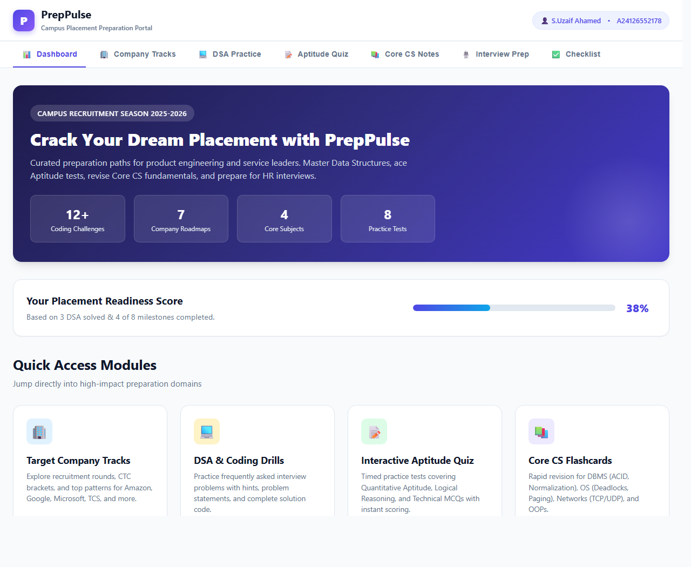
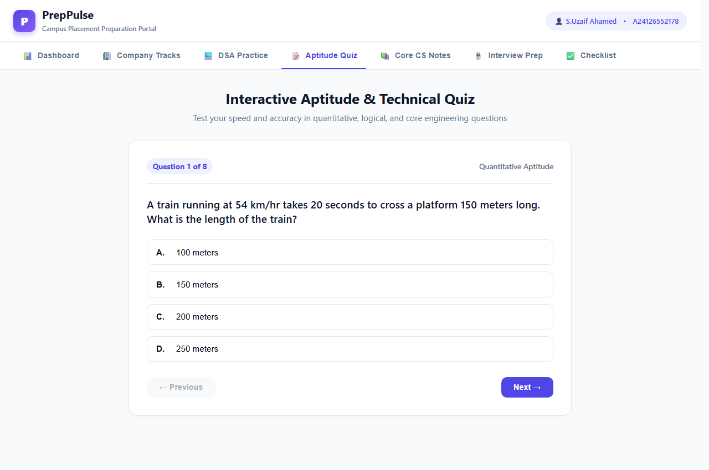
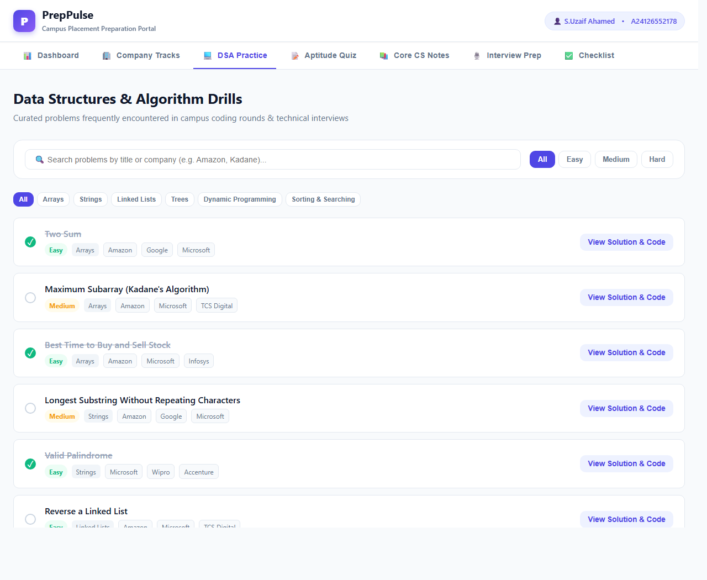
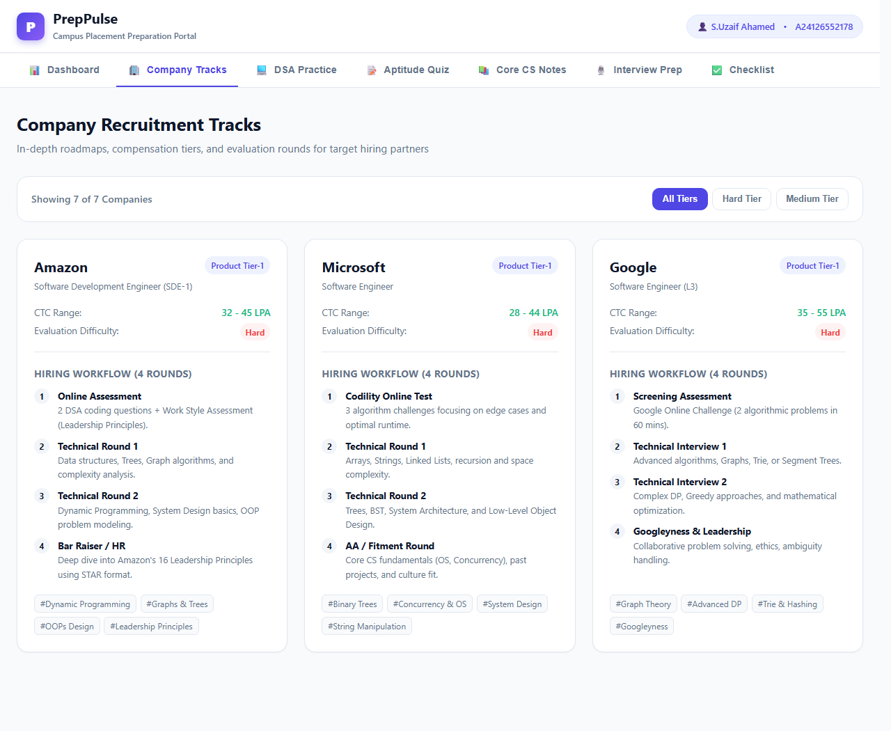

# Placement Preparation Portal

A full-stack MERN mini project for college placement preparation.

**Student Name:** S.Uzaif Ahamed  
**Registration Number:** A24126552178  

---

## 📸 Screenshots

### 1. Student Dashboard & Placement Readiness Gauge


### 2. Aptitude & Technical Quiz with Scoring


### 3. Coding Practice Problems & Solution Viewer


### 4. Company Recruitment Tracks


---

## Features
- **JWT-based registration and login:** Secure student authentication using bcryptjs and JSON Web Tokens.
- **Student dashboard with progress statistics:** Live placement readiness score, problems solved counter, and recent quiz attempts.
- **Aptitude quiz with scoring and saved attempts:** Interactive assessment engine with category filtering, timers, immediate scoring, and question explanations.
- **Interview question bank by category:** High-frequency HR behavioral (STAR method) and technical interview questions (DBMS, OS, CN, OOPs).
- **Coding practice problem list with difficulty filters:** Algorithmic challenges with tags, difficulty pills, hints, and JavaScript solution code.
- **Profile page and progress history:** View academic details, recent quiz performances, and solved challenge milestones.
- **MongoDB persistence with demo seed data:** Mongoose models with automated seed script (`npm run seed`) for quick setup.
- **Responsive UI:** Clean, modern developer interface supporting desktop, tablet, and mobile displays.

---

## Tech stack
- **Frontend:** React + Vite + React Router DOM
- **Backend:** Node.js + Express
- **Database:** MongoDB + Mongoose
- **Authentication:** bcryptjs + JSON Web Tokens (JWT)

---

## Prerequisites
- Node.js 18+
- MongoDB Community Server or a MongoDB Atlas connection URI

---

## Run locally

### 1. Backend
```bash
cd server
copy .env.example .env
npm install
npm run seed
npm run dev
```
Set `MONGO_URI` and `JWT_SECRET` in `server/.env` before starting.

### 2. Frontend
In a second terminal:
```bash
cd client
npm install
npm run dev
```
Open the URL shown by Vite (usually `http://localhost:5173`).

The frontend expects the API at `http://localhost:5000/api`. Set `VITE_API_URL` in `client/.env` if needed.

---

## Demo workflow
1. Register a new account (or login with prefilled demo credentials).
2. Open **Aptitude** and complete an assessment quiz.
3. View your updated score and readiness percentage on the **Dashboard**.
4. Browse **Interview Questions** and solve problems in **Coding Practice**.
5. Check your progress and attempt records in **Profile**.

---

## Project Structure
```text
Assignment-2-Individual-Project/
├── README.md
├── screenshots/
│   ├── 01-dashboard-overview.png
│   ├── 02-company-recruitment-tracks.png
│   ├── 03-dsa-coding-practice.png
│   └── 04-aptitude-quiz.png
├── server/
│   ├── package.json
│   ├── .env.example
│   ├── server.js
│   ├── seed.js
│   ├── middleware/
│   │   └── auth.js
│   ├── models/
│   │   ├── User.js
│   │   ├── QuizQuestion.js
│   │   ├── QuizAttempt.js
│   │   ├── InterviewQuestion.js
│   │   └── CodingProblem.js
│   └── routes/
│       ├── auth.js
│       ├── user.js
│       ├── quiz.js
│       ├── coding.js
│       └── questions.js
└── client/
    ├── package.json
    ├── vite.config.js
    ├── index.html
    ├── .env.example
    └── src/
        ├── main.jsx
        ├── App.jsx
        ├── index.css
        ├── context/
        │   └── AuthContext.jsx
        ├── components/
        │   ├── Navbar.jsx
        │   └── ProtectedRoute.jsx
        ├── data/
        │   └── mockData.js
        └── pages/
            ├── Dashboard.jsx
            ├── Login.jsx
            ├── Register.jsx
            ├── Aptitude.jsx
            ├── Coding.jsx
            ├── Interview.jsx
            └── Profile.jsx
```

---

## Security notes
- Never commit your real `.env` files or secrets.
- `.env.example` contains placeholders only.
- This is a college mini-project starter. Before public production use, add email verification, password reset, rate limiting, stronger input validation, and deployment-specific security configuration.
