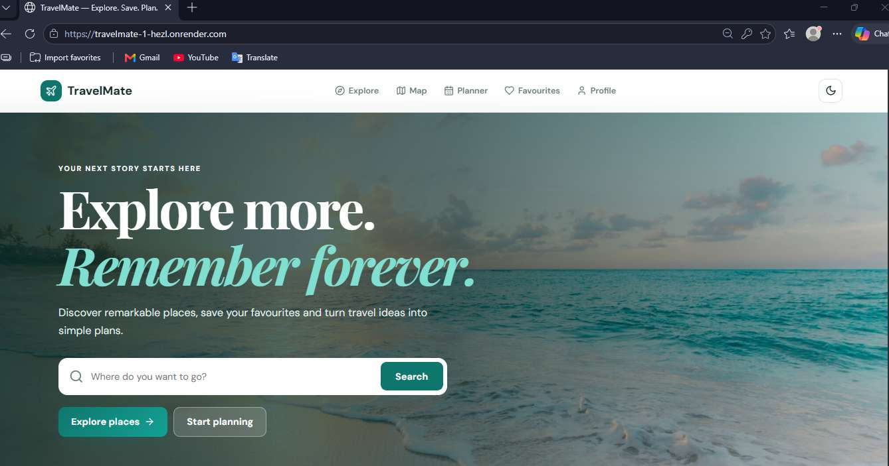
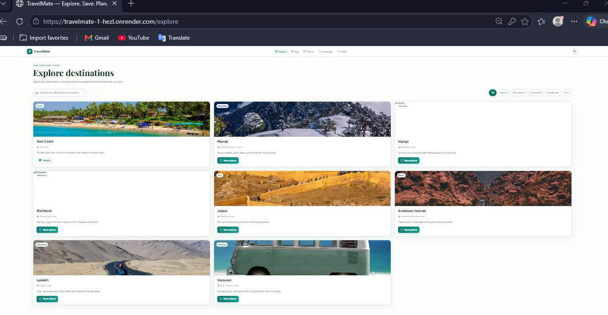
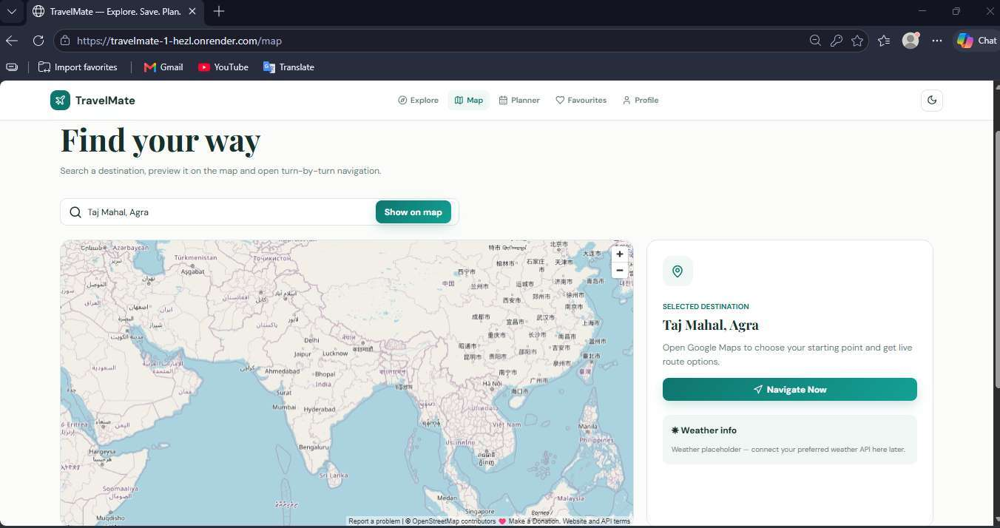
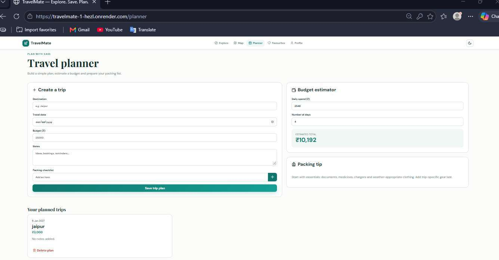
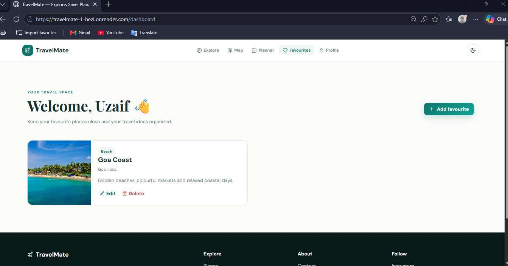
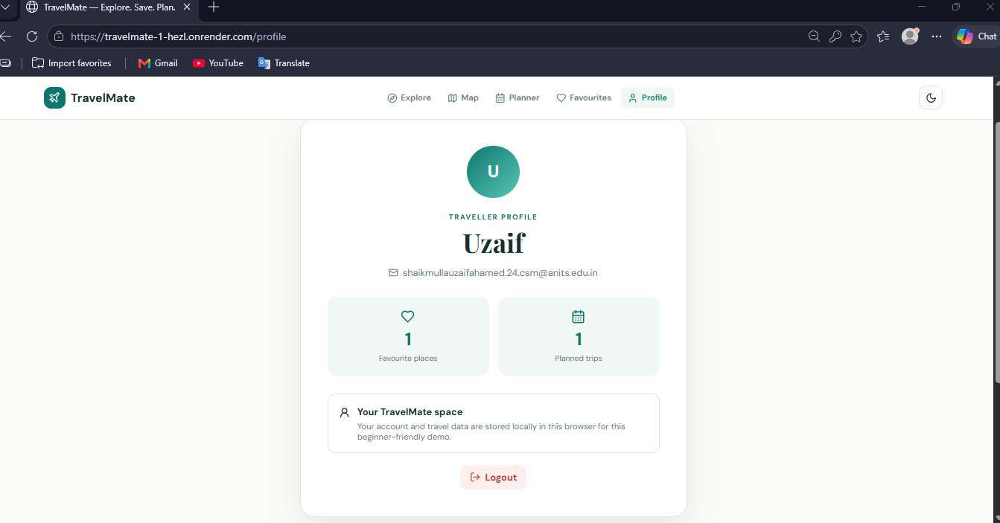

# Group Project: TravelMate

**Live site:** [https://travelmate-1-hezl.onrender.com](https://travelmate-1-hezl.onrender.com)

A responsive React travel web app built with Vite, React Router, reusable components, and browser `localStorage`.

## 👥 Team
| Name | Roll No |
|---|---|
| Sari Dharani | A24126552176 |
| S.Uzaif Ahamed | A24126552178 |

---

## 📸 Screenshots

### 1. Landing Page


### 2. Explore Destinations


### 3. Interactive Map & Google Maps Navigation


### 4. Travel Planner & Budget Estimator


### 5. User Travel Space & Favourite Places


### 6. Traveller Profile


---

## 🚀 Features
- **Landing page:** Hero search, featured places, and travel tips.
- **Registration & login:** Form validation with persistent `localStorage` session.
- **Protected routes:** Guarded dashboard, travel planner, and user profile.
- **Favourite places:** Create, edit, and delete custom travel destinations.
- **Destination search:** OpenStreetMap Nominatim search integration and category filters.
- **Interactive Map:** OpenStreetMap embed with a direct Google Maps turn-by-turn navigation link.
- **Trip planner:** Budget estimator and interactive packing checklist.
- **UI/UX enhancements:** Dark/light mode, toast notification messages, and custom empty states.

---

## 📁 Folder Layout
```text
Group-Project/
├── README.md
├── screenshots/
│   ├── group_project_screenshots.pdf        # Complete multi-page PDF document
│   ├── 01-landing-page.png
│   ├── 02-explore-destinations.png
│   ├── 03-interactive-map.png
│   ├── 04-travel-planner.png
│   ├── 05-user-dashboard.png
│   └── 06-traveller-profile.png
├── client/                                  # React + Vite application
└── server/                                  # Backend documentation
```

---

## ⚡ How to Run
```bash
cd client
npm install
npm run dev
```
For production build:
```bash
npm run build
npm run preview
```

---

## 📄 Screenshots File
The complete consolidated PDF is available at:  
👉 [`screenshots/group_project_screenshots.pdf`](./screenshots/group_project_screenshots.pdf)
